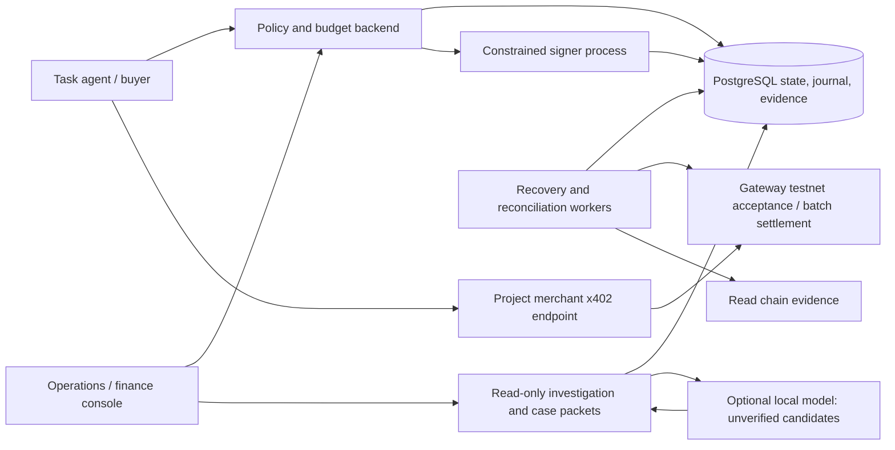

# Stage 16 Portfolio acceptance and scope closure

The agreed portfolio implementation is complete through Stage 16. AgentTreasury
combines a controlled testnet payment backend with evidence-backed operations and
an optional, evaluated agent layer. Completion means the code, regression checks,
archived acceptance replay, annotation workflow and handoff are delivered. It does
not mean production certification or demonstrated AI productivity improvement.

The [machine-readable acceptance report](evidence/portfolio-acceptance.json) is the
current source for execution time, test totals, Node version, step outcomes and
source/compiled-file hashes. It distinguishes local tests from historical testnet
acceptance and marks external outcomes unverified.

## Proposal to implementation

The original `AgentTreasury_Proposal.docx` sits beside the repository. Its SHA-256
at review was `bd46f8a5e0c5ba22a52689d9e65089ee3f979a14bc878d44f722f446e28ebe9b`.
Its text described a Base Sepolia research agent buying market data. The accepted
scope later moved to Arc testnet Gateway payments, transaction-trace delivery as
the business carrier, and buyer-side recovery/reconciliation. The table records
those changes rather than claiming every original aspiration shipped unchanged.
The Word file was read for content comparison, not edited or reissued.

| Original requirement or later accepted scope | Current capability and evidence | Acceptance boundary |
| --- | --- | --- |
| Single agent, approved data API, task budget | HTTP task/service authorization, quote validation, reserved/spent accounting; [payment tests](../test/payments.test.ts), [Gateway budget tests](../test/gateway-budget.test.ts) | Project-operated merchant and fixture data; no third-party service-quality claim |
| Base Sepolia x402 EIP-3009 | Legacy rail retained; primary path is Arc testnet + Gateway batch settlement | Scope changed deliberately; Base is no longer the principal portfolio story |
| Durable request and nonce identity | Original authorization reused during ambiguous outcomes; bounded worker retries and review escalation | A valid already-issued signature is not cryptographically revoked by an application freeze |
| Concurrent budget enforcement | Task/daily reservation transactions and grant/version checks; A→B→A recipient-change regression | Tested invariants under injected races, not a mathematical guarantee for all incidents |
| Isolated signing | Separate executable signer with request-bound terms, allowlist and amount cap; [signer tests](../test/gateway-signer.test.ts) | Local key file/shared DB trust; no HSM/MPC, separate-user custody or wallet-native enforcement claim |
| Valid real testnet purchase | [Modern signing acceptance](stage-6-signing-acceptance.md): 0.001 test USDC, one signature, one journal, delivered and reconciled; retry preserved identity | Historical captured run; final acceptance replays its saved evidence, not a new live payment |
| Lost response and restart | Recovery and actual signer process kill/restart tested with disposable PostgreSQL/loopback services | Testnet/provider incident coverage and extended soak remain unverified |
| Refund and delivery conflicts | Operator approval, full-refund evidence, intent-before-broadcast, uncertain refund recovery; [refund-send tests](../test/gateway-refund-send.test.ts) and [dispute flow](../test/gateway-dispute-refund-flow.test.ts) | At-most-once automatic broadcast; uncertain broadcasts require investigation, not blind resend |
| Double-entry accounting | Payment/refund postings and state updates bound transactionally; exact transfer evidence checks | No general-purpose finance adjustment or automatic correcting-entry product |
| Independent balance reconciliation | Batch/ledger checks, wallet-window arithmetic, saved events/checkpoints and offline replay; [balance tests](../test/gateway-balance-scan.test.ts) | Bounded finalized windows and shared RPC trust; not full-chain proof or per-nonce cryptographic inclusion |
| Reorg handling | Changed finalized hashes stop ingestion; evidence/cursor updates are fenced and atomic | No automatic canonical rewrite or general unconfirmed-history rollback engine |
| Operations and audit | Durable versioned cases, metrics, worker leases, cold backup/restore; [operations tests](../test/gateway-operations.test.ts) | Role identity, not SSO/person/tenant isolation; audit hash chain has no external anchor |
| Agent investigation | Bounded read-only tools, citation/source validation, stale evidence handling, exploratory multi-step evaluation | Model interpretations remain advisory; no demonstrated stable advantage over stronger rules |
| Dispute case preparation | Source-bound packet, supplemental material, immutable revisions, concurrent version checks, context holds | Human topic selection does not verify claims or authorize funds; English cues can miss or over-hold issues |
| Agent evaluation and operator measurement | Rule/model comparisons, status/failure denominators, client timing provenance, validated annotation import and disagreements | Development cases and self-declared reviewers; independent annotations and human time savings unverified |
| Deployable API/workers, Compose and CI | Docker/Compose and GitHub workflow files; migrations through 040; local acceptance command below | Configuration is present; no container/CI-run result or production soak is asserted here |
| OpenAPI, MCP, general supplier marketplace | HTTP endpoints and documented console workflows exist | No generated OpenAPI specification or MCP server; discovery, smart routing and marketplace infrastructure deferred |
| Original research-agent business narrative | A controlled trace-purchase workflow replaces the camping-lantern research example | No autonomous sourcing research or 40–60% cost reduction has been established |

Mainnet, real money, a frozen 7B rerun, A402 fair exchange, payee cryptographic
verification, database splitting and message queues remain explicitly outside this
version. They are not prerequisites for closing this portfolio release.

## Reproduce local acceptance

Use Node 22 or later and install the locked dependencies on a fresh checkout with
`npm ci`. Installation may need network access. The acceptance runner itself needs
local socket permissions for disposable PostgreSQL and loopback HTTP fixtures; it
does not require Docker, Ollama, a Circle login, a faucet, a wallet or `.env`.

```sh
npm run verify:portfolio -- --output /tmp/agenttreasury-acceptance-new.json
```

Use a new filename and an existing output directory. The runner refuses report or
sidecar collisions, compiles the project, runs the complete tests, replays the
archived modern signing evidence, runs a rules-only packet evaluation, and exports
a blank schema-v2 review form. It strips inherited wallet/database/model settings
from child processes, uses no dotenv loader and invokes no live payment launcher.
Tests create and clean up their own temporary databases; existing local user stores
are not migrated, restarted or deleted.

A successful report requires all tests to pass with zero skips/cancellations,
complete offline replay and export steps, and unchanged executable source/build
hashes throughout verification. A failed step produces `passed: false`, a nonzero
exit code and the available logs. Partial or empty evaluation sidecars are not
successful runs. The runner's labels express the tested scope, not an OS-level
network sandbox or independent attestation.

Artifacts include TAP test output, offline signing verification, the rules evaluation
with its plan/per-case journal and an unfilled review form. The [included form](evidence/portfolio-acceptance.json.review-form.json)
contains no reviewer answers. Use [Stage 15](stage-15-annotation-import.md) for actual
review import and comparison. Operator console usage remains documented in
[Stage 11](stage-11-case-packet-review.md) and [Stage 14](stage-14-case-packet-context.md).

## Architecture and authority



The diagram does not imply a distributed trust boundary between backend DB owners
and the signer. The signer/API boundary is real and tested; OS-enforced key custody
and independently controlled databases are not. Model output cannot authorize a
signature, payment, refund or journal correction. Finance decisions and evidence
validation remain in deterministic backend paths.

## Hiring position and limits

Use [project highlights](project-highlights.md) as the concise narrative. This is
strongest as a TypeScript/PostgreSQL payments and agent-platform engineering project:
idempotency under uncertain external outcomes, constrained authorization, auditable
recovery, reconciliation, and safe integration of probabilistic suggestions.

No specific current Circle job description was supplied or independently checked
for this closeout. The match is to those technical responsibilities, not a verified
opening, internal team design or claim that Circle lacks equivalent infrastructure.
A strong model-research or proven agent-ROI claim is not supported by the results.

## Closure and remaining external evidence

There is no further mandatory implementation stage for this version. The remaining
work is evidence collection: real independent review of new cases, measured operator
outcomes, or separately authorized deployment/soak acceptance. None is represented
as completed by a simulation. Freeze the scope, use the reproducible package for
interviews, and only reopen implementation for a concrete defect or business need.
